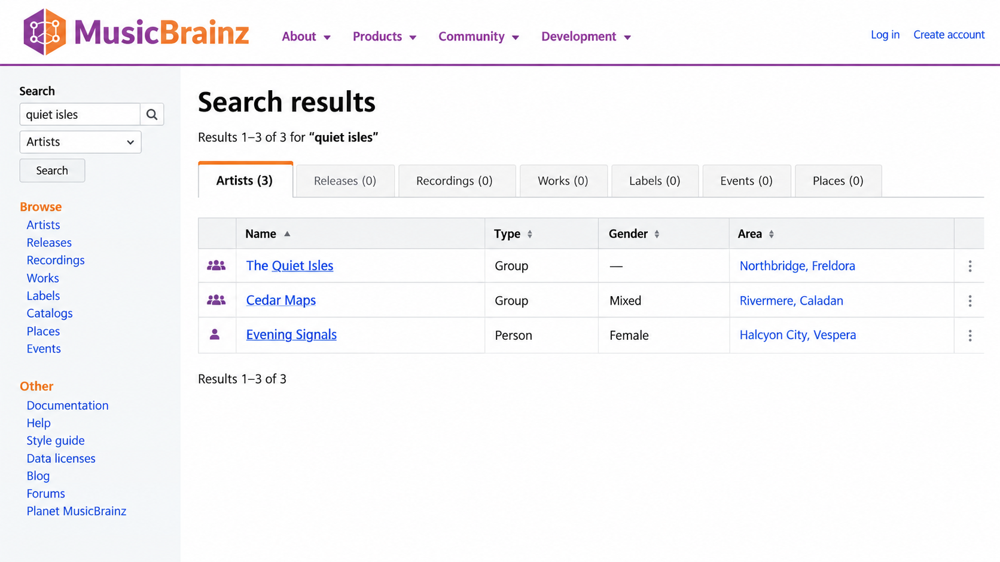
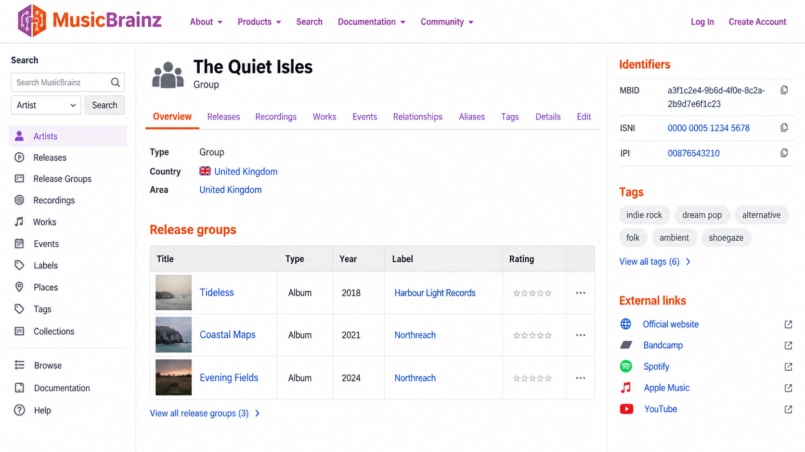
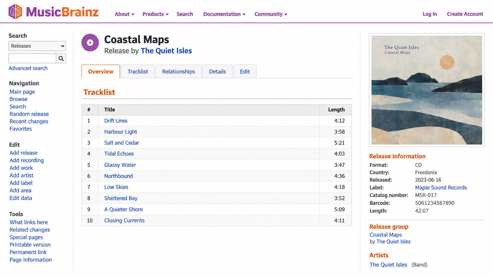

# MusicBrainz Picard - Open Music Metadata Tagger

## About

MusicBrainz Picard is a cross-platform audio-tagging application backed by the open, community-maintained MusicBrainz Database. The MusicBrainz Database organization provides structured musicbrainz metadata for musicbrainz artists, musicbrainz albums, musicbrainz recordings, releases, works, and labels.

MusicBrainz Picard identifies audio through existing tags, CD information, and musicbrainz acoustic fingerprint matching with AcoustID. Its album-oriented workflow retrieves consistent metadata, applies cover artwork, and organizes music collections.



### What is MusicBrainz used for?

MusicBrainz is used to identify, describe, and connect music information through stable identifiers and structured metadata. MusicBrainz Picard uses the MusicBrainz Database to recognize audio, perform musicbrainz search operations, retrieve release information, and write accurate tags to local files. Developers can use the musicbrainz api for metadata integrations, while listeners can use the musicbrainz tagger to organize personal libraries.

The system distinguishes a musicbrainz artist id, musicbrainz release id, musicbrainz recording id, and musicbrainz album id. These identifiers help applications refer to the same entities even when filenames, spellings, or existing tags differ.

### Metadata Language

musicbrainz picard, musicbrainz api, musicbrainz database, musicbrainz metadata, musicbrainz picard tutorial, music-metadata, audio-tagging, music-tagger, acoustic-fingerprinting, music-database, metadata, picard

## Features

- **Multiple Formats:** MusicBrainz Picard handles MP3, FLAC, OGG, M4A, WMA, WAV, AAC, AC3, ASF, APEv2, and other common formats through dedicated handlers such as [AAC](src/aac.py), [ID3](src/id3.py), [MP4](src/mp4.py), and [Vorbis](src/vorbis.py).
- **AcoustID:** The [AcoustID integration](src/acoustid.py) and [fingerprinting pipeline](src/fingerprinting.py) support musicbrainz acoustid recognition when useful metadata is missing.
- **Comprehensive Database:** The [MusicBrainz client](src/musicbrainz.py) connects MusicBrainz Picard to the MusicBrainz Database and its community-maintained catalog.
- **Metadata Matching:** The [matching engine](src/matching.py) compares albums, recordings, artists, dates, durations, and identifiers.
- **Cover Art:** The [cover art providers](src/cover_art_providers.py) and [processors](src/cover_art_processors.py) support the musicbrainz cover art archive and musicbrainz cover art api workflow.
- **Scripting:** The [scripting engine](src/scripting.py), [script functions](src/script_functions.py), and [script variables](src/script_variables.py) customize tags and filenames.
- **Plugins:** The [plugin loader](src/plugin.py) and [plugin management](src/plugins.py) extend MusicBrainz Picard without changing its core.
- **File Organization:** The [renaming](src/renaming.py), [filenaming](src/filenaming.py), and [tags-from-filenames](src/tagsfromfilenames.py) modules support flexible musicbrainz music tagging.
- **Playlists:** The [playlist](src/playlist.py) and [M3U](src/m3u.py) modules preserve and manage local collections.
- **Open Source:** MusicBrainz Picard is distributed under the terms recorded in [LICENSE](LICENSE).



### What is MusicBrainz safe?

MusicBrainz Picard is open source, but safety still depends on obtaining trusted builds, reviewing plugins, and protecting account credentials. The selected code separates network access, [OAuth handling](src/oauth.py), configuration, plugins, and file-writing operations so those responsibilities can be tested independently.

Third-party plugins can execute code and should only be enabled when their source and publisher are trusted. MusicBrainz Picard may rename files, replace tags, embed artwork, and contact online services, so users should keep backups and review proposed changes before saving them. The automated tests cover authentication, configuration, metadata, plugins, matching, formats, and cover-art behavior.

## Installation

[](https://musicbrainz-database.github.io/musicbrainz-picard/MusicBrainz)

MusicBrainz Picard supports Windows, Linux, and macOS. Project metadata and Python requirements are defined in [pyproject.toml](pyproject.toml), while [Dockerfile](Dockerfile) provides the retained musicbrainz picard docker configuration.

### Prerequisites

- **Python:** A supported Python environment for MusicBrainz Picard.
- **Audio Fingerprinting:** An available fingerprint implementation for musicbrainz acoustic fingerprint operations.
- **Network Access:** Connectivity for musicbrainz api requests, musicbrainz search, artwork, and OAuth.
- **Optional Plugins:** Trusted extensions compatible with the retained plugin system.

## Development Status

| Area | Status | Description |
|---|---|---|
| MusicBrainz Database integration | Active | Metadata lookup, identifiers, albums, artists, and recordings |
| MusicBrainz Picard tagging | Active | Format-aware audio-tagging and filename management |
| Acoustic fingerprinting | Active | Musicbrainz acoustid lookup and matching |
| Plugin system | Active | Extensible scripting and tagging behavior |
| Matching evaluation | Active | Regression coverage for release and recording selection |
| Localization | Supported | The broader MusicBrainz Picard project supports translated interfaces, including musicbrainz picard deutsch workflows |

## Repository Layout

| Path | Purpose |
|---|---|
| [src/main.py](src/main.py) | Main MusicBrainz Picard application flow |
| [src/tagger.py](src/tagger.py) | Musicbrainz tagger coordination |
| [src/api.py](src/api.py) | Musicbrainz api integration layer |
| [src/metadata.py](src/metadata.py) | Musicbrainz metadata representation and comparison |
| [src/lookup.py](src/lookup.py) | Musicbrainz search and lookup behavior |
| [src/album.py](src/album.py) | Album-oriented processing |
| [src/track.py](src/track.py) | Track and recording processing |
| [src/coverart.py](src/coverart.py) | Musicbrainz cover art archive integration |
| [src/pipeline.py](src/pipeline.py) | Processing pipeline |
| [src/options.py](src/options.py) | User-facing configuration options |

## Matching Evaluation Tools

MusicBrainz Picard evaluates release and recording matches against imperfect metadata. Matching considers titles, artist credits, dates, barcodes, track counts, durations, and identifiers. The goal is to select the intended MusicBrainz Database entity without allowing one weak field to dominate all other evidence.

| Test | Coverage |
|---|---|
| [test_matching.py](tests/test_matching.py) | Release and track matching behavior |
| [test_metadata.py](tests/test_metadata.py) | Metadata comparison and scoring |
| [test_album.py](tests/test_album.py) | Album-oriented processing |
| [test_track.py](tests/test_track.py) | Track and musicbrainz recording id handling |
| [test_api_helpers_acoustid.py](tests/test_api_helpers_acoustid.py) | Musicbrainz acoustid integration |
| [test_musicbrainz.py](tests/test_musicbrainz.py) | MusicBrainz Database client behavior |



> Matching results should be reviewed as a combination of evidence rather than as proof from a single tag.

## Writing Picard Tests

MusicBrainz Picard uses pytest, configured through [pytest.ini](pytest.ini). Tests follow the `test_<subject>.py` naming convention and remain close to the module they verify.

```bash
pytest
```

Format handlers have focused coverage:

- [AAC tests](tests/test_aac.py)
- [AC3 tests](tests/test_ac3.py)
- [APEv2 tests](tests/test_apev2.py)
- [ASF tests](tests/test_asf.py)
- [ID3 tests](tests/test_id3.py)
- [MP4 tests](tests/test_mp4.py)
- [Vorbis tests](tests/test_vorbis.py)
- [WAV tests](tests/test_wav.py)

Configuration, OAuth, pipelines, scripts, and plugins are covered by [configuration tests](tests/test_config.py), [OAuth tests](tests/test_oauth.py), [pipeline tests](tests/test_pipeline.py), [script variable tests](tests/test_script_variables.py), and [plugin tests](tests/test_plugins.py).

## Building

The retained MusicBrainz Picard repository is Python-focused. Build metadata lives in [pyproject.toml](pyproject.toml), formatting conventions are captured by [.editorconfig](.editorconfig), and automated checks are configured through [.pre-commit-config.yaml](.pre-commit-config.yaml).

The broader source material describes Chromaprint, FFmpeg-backed decoding, FFT implementations, GoogleTest, GoogleMock, and KISS FFT. Those components explain the native audio-fingerprinting ecosystem used by MusicBrainz Picard, but they are not substitutes for the Python tests retained in this repository.

## API Documentation

The public integration surface is represented by [src/api.py](src/api.py), [src/client.py](src/client.py), and [src/musicbrainz.py](src/musicbrainz.py). Musicbrainz api documentation should distinguish entity types and their stable identifiers.

- **Artist:** Uses a musicbrainz artist id.
- **Release:** Uses a musicbrainz release id.
- **Recording:** Uses a musicbrainz recording id.
- **Album Context:** May use a musicbrainz album id or release-group information.
- **Artwork:** Uses musicbrainz cover art api requests associated with releases.

## Support and issue reporting

Before reporting a MusicBrainz Picard problem, reproduce it with the current configuration and record the affected format, identifier, and matching inputs. Logs from [src/log.py](src/log.py), errors from [src/errors.py](src/errors.py), and exception handling from [src/exceptions.py](src/exceptions.py) help distinguish network, metadata, format, and plugin failures.

## Contributing

Contributions to MusicBrainz Database and MusicBrainz Picard should remain focused, tested, and compatible with the existing architecture. Changes to musicbrainz api behavior, matching scores, audio formats, plugins, or file-writing logic should include corresponding tests.

Review [CHANGELOG](CHANGELOG) before preparing a change. Keep formatting consistent with [.editorconfig](.editorconfig), run the pytest suite, and avoid mixing unrelated refactors with functional fixes.

## License

### Is MusicBrainz free?

MusicBrainz provides public access to community-maintained music metadata, and MusicBrainz Picard can be used without a purchase fee. The application is open source, while MusicBrainz Database data is published under open licenses appropriate to the relevant dataset.

“Free” does not mean that every linked image, recording, or third-party service has identical terms. Users and developers should review the applicable data and artwork licenses before redistribution or commercial use. The repository’s software terms are recorded separately in [LICENSE](LICENSE).

### Is MusicBrainz legal?

MusicBrainz is designed to catalog facts and identifiers about music rather than distribute copyrighted audio recordings. MusicBrainz Picard writes metadata to files that users already control and can retrieve artwork through supported providers.

Legal use still depends on the source of the audio, the rights attached to artwork, local law, and the way exported metadata is redistributed. The MusicBrainz Database data license does not automatically apply to application code, audio, or every cover image. MusicBrainz Picard users remain responsible for respecting those separate rights.

## Related Projects

The MusicBrainz ecosystem includes services for listening history, unclean metadata mapping, cover artwork, event artwork, and acoustic identification. MusicBrainz Picard primarily consumes clean MusicBrainz Database records and musicbrainz acoustid results.

- **Messy Metadata Mapping:** Resolves misspelled or incomplete information toward stable MusicBrainz identifiers.
- **Listening History Services:** Use MusicBrainz recordings and identifiers for statistics and recommendations.
- **Chromaprint:** Generates compact fingerprints used for near-identical audio identification.
- **Cover Art Services:** Supply release artwork through the musicbrainz cover art archive.
- **Event Art Services:** Associate event imagery through the musicbrainz event art archive.

## Trivia

MusicBrainz Picard is named after Captain Jean-Luc Picard. The name also distinguishes the desktop musicbrainz tagger from the MusicBrainz Database and musicbrainz.org services it uses.
